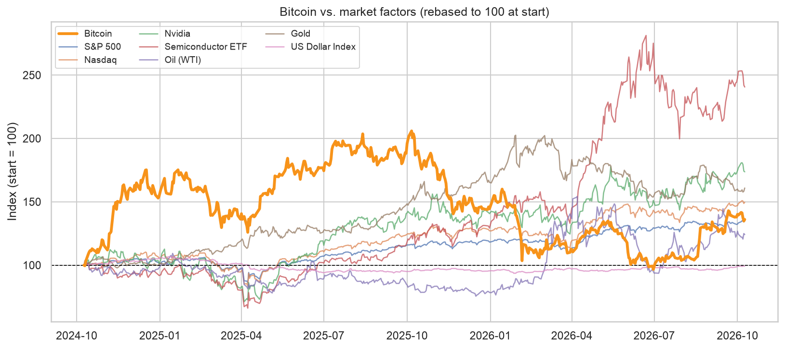
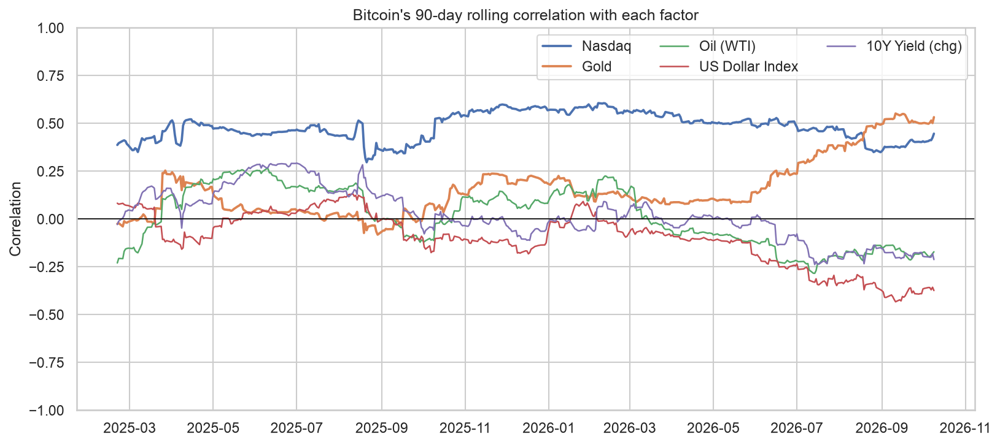
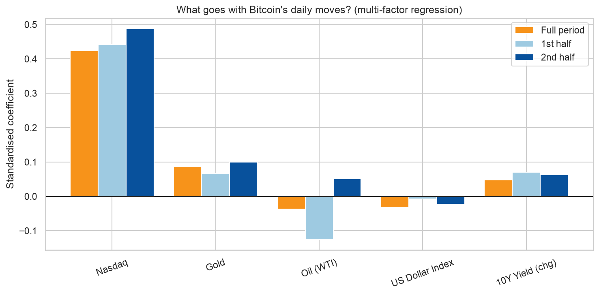
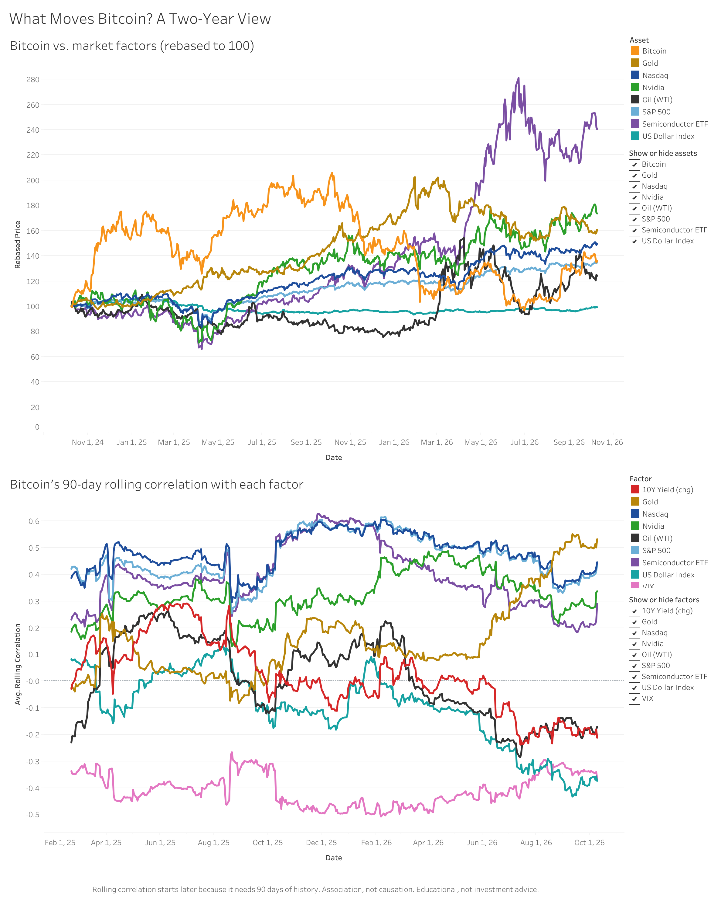

# What Moves Bitcoin? Stocks, AI, Oil, Gold, the Dollar and Interest Rates

Data as of 9 Oct 2026 (Yahoo Finance)

An end-to-end data analytics project in Python, Excel and Tableau.

> **Question:** What has moved Bitcoin's price over the last 2 years: stocks, AI/tech, oil, gold, the dollar, or interest rates? And has that relationship changed over time?

## Key findings
1. **Nasdaq was the strongest link.** Bitcoin's daily returns had a correlation of 0.44 with the Nasdaq (S&P 500: 0.42), compared with only 0.15 for gold.
2. **The Nasdaq link stayed positive throughout.** The 90-day rolling correlation with the Nasdaq averaged 0.48 and never fell below 0.30 (peak 0.61), versus an average of 0.16 for gold (range -0.08 to 0.55).
3. **The gold link grew.** Bitcoin's correlation with gold rose from 0.03 in the first half to 0.22 in the second half. The US dollar (-0.18) and the 10-year yield (-0.17) shifted by similar amounts in the opposite direction.
4. **Most daily moves are unexplained.** In a regression using the Nasdaq, gold, oil, the dollar and yield changes, only the Nasdaq was clearly significant (gold was borderline). Together the five factors explain 20% of Bitcoin's daily variance.
5. **Bitcoin lagged, with deep drawdowns.** Over the two years Bitcoin returned about +36%, versus +50% for the Nasdaq and +61% for gold, with a maximum drawdown of -53%. It is currently 34% below its peak, while the Nasdaq is within 1% of its own.

## Visuals




## Approach
1. **Data:** daily prices for Bitcoin and 9 factors (S&P 500, Nasdaq, Nvidia, semiconductor ETF, WTI oil, gold, US Dollar Index, VIX, 10-year yield) from Yahoo Finance via `yfinance`.
2. **Cleaning:** aligned to US trading days, forward-filled short gaps, converted to log returns (yield as daily change).
3. **Analysis:** summary stats and drawdowns, correlation matrix, 90-day rolling correlations, first-half vs second-half comparison, standardised multi-factor regression, event study.
4. **Communication:** notebook narrative, Excel workbook, Tableau dashboard.

## Repository structure
```
bitcoin_drivers_analysis.ipynb   # main analysis
data/raw/                        # cached download
data/processed/                  # clean CSVs + Excel workbook (Tableau-ready)
images/                          # charts used in this README
requirements.txt
```

## How to run
```bash
python -m venv venv
source venv/bin/activate        # Windows: venv\Scripts\activate
pip install -r requirements.txt
jupyter notebook bitcoin_drivers_analysis.ipynb
```
Run all cells. Delete `data/raw/prices_raw.csv` to download fresh data.

## Tableau dashboard
[](https://public.tableau.com/app/profile/serhii.popeliuk/viz/BitcoinDriversDashboard/WhatMovesBitcoinATwo-YearView)

[View the interactive dashboard on Tableau Public](https://public.tableau.com/app/profile/serhii.popeliuk/viz/BitcoinDriversDashboard/WhatMovesBitcoinATwo-YearView)

Built from `data/processed/prices_rebased_long.csv` and `data/processed/rolling_correlation_long.csv`.

## Limitations
Association, not causation; a single two-year regime; daily-return noise; political and AI effects are proxied. See the notebook for details.

## Author
**Serhii Popeliuk**: [LinkedIn](https://www.linkedin.com/in/serhii-popeluk) | [Tableau Public](https://public.tableau.com/app/profile/serhii.popeliuk)

*Educational project, not investment advice.*